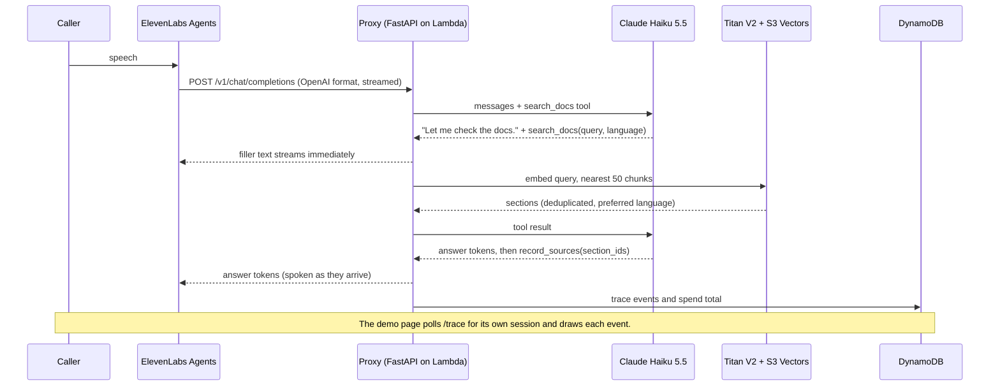

# FastAPI Docs Voice Agent

A bilingual (English and Spanish) voice agent that answers questions from the FastAPI documentation, with a live trace that shows every step behind each answer: whether it decided to search, the query it wrote, the doc sections it retrieved, time to first token, and cost.

ElevenLabs handles the voice. Claude decides, searches and answers through a small FastAPI proxy on AWS Lambda. Retrieval uses Titan V2 embeddings in S3 Vectors.

All results below use the frozen 68-row gold set (tag `eval-freeze-v1`). The full list of misses and their causes is in [FAILURES.md](FAILURES.md).

| | |
|---|---|
| Answers the judge passes (Opus 5.5, blind) | 61 of 68 (0.90 [0.82, 0.96]) with Haiku 5.5, 65 of 68 with Sonnet 5.5 |
| Right doc section in the top 5 | 0.96 [0.90, 1.00] on 50 answerable questions |
| Right doc section ranked first | 0.64 [0.50, 0.76], +0.20 [0.02, 0.38] over the local hybrid baseline |
| Searches when it should / skips when it should | 60 of 60 doc questions / 8 of 8 small-talk turns |
| Retrieval inside Lambda (Titan embed + S3 Vectors query) | 127 to 160 ms (8 searches) |
| Claude cost per turn | about $0.0006 (Haiku 5.5) |

## Try it

- Live demo: `https://djsuuhec353rb2swjznsdofvlu0ejmpm.lambda-url.us-east-2.on.aws/`. It needs a demo code to protect API credits. Ask the author for one.
- Press **Start call**, allow the microphone, and ask in English or Spanish. The right panel fills in as the agent works.

## How one turn works



- **Custom LLM proxy.** ElevenLabs speaks the OpenAI Chat Completions streaming format. The proxy translates it to the Anthropic Messages API and back, so Claude runs the agent loop while ElevenLabs only does speech.
- **Two tools, one hidden.** `search_docs` is Claude's choice, so small talk skips retrieval. `record_sources` is called after the spoken answer to log citations without reading them aloud.
- **Trace events.** `user_utterance`, `decision`, `tool_call`, `retrieval_hits`, `llm_first_token`, `answer_done`, `external_tool`, `error`. One schema feeds the live panel, the eval logs and the latency numbers.

## Results

### Retrieval

All retrievers are scored on the same queries Claude wrote for the 50 answerable questions (`eval/ablation.py`), so the differences are paired. Intervals are 95% bootstrap.

| Retriever | Recall@1 | Recall@5 | MRR@10 |
|---|---|---|---|
| BM25 only | 0.44 [0.30, 0.56] | 0.90 [0.82, 0.98] | 0.64 [0.55, 0.73] |
| Local embeddings only (multilingual MiniLM) | 0.48 [0.34, 0.62] | 0.92 [0.84, 0.98] | 0.65 [0.55, 0.75] |
| Local hybrid (MiniLM + BM25, RRF) | 0.44 [0.30, 0.58] | 0.96 [0.90, 1.00] | 0.66 [0.57, 0.75] |
| Titan V2 + BM25 (RRF) | 0.58 [0.44, 0.72] | 0.96 [0.90, 1.00] | 0.74 [0.66, 0.83] |
| **Titan V2 only (deployed)** | **0.64 [0.50, 0.76]** | **0.96 [0.90, 1.00]** | **0.78 [0.69, 0.86]** |

- Titan alone beats the local hybrid on ranking the right section first: recall@1 +0.20 [0.02, 0.38], MRR@10 +0.13 [0.01, 0.24]. Recall@5 ties.
- Adding BM25 to Titan doesn't help here: recall@1 −0.06 [−0.20, 0.10].
- Letting Claude rewrite the question into a search query matters more than the retriever. With the raw question, the local hybrid reaches recall@5 0.78 [0.66, 0.88], and spoken-style questions only 0.65.

### Answer quality

Every gold row was run through the full agent loop (same prompt, tools and greeting as the live call, `aws-dense` retrieval). Claude Opus 5.5 judged each answer without knowing the model. It saw the question, the reference answer and the retrieved sections, and decided whether the answer was correct and grounded in those sections (`eval/answer_eval.py`).

| | Haiku 5.5 (deployed) | Sonnet 5.5 |
|---|---|---|
| Judge pass, 68 rows | 0.90 [0.82, 0.96] | 0.96 [0.90, 1.00] |
| Correct, 50 answerable rows | 0.98 [0.94, 1.00] | 0.98 [0.94, 1.00] |
| Grounded in retrieved text | 0.92 [0.84, 0.98] | 0.96 [0.90, 1.00] |
| Unanswerable rows passed | 8 of 10 | 10 of 10 |
| Small talk answered without searching | 8 of 8 | 8 of 8 |
| Claude cost per turn | $0.00057 | $0.0198 |

- Sonnet minus Haiku on judge pass is +0.06 [−0.015, 0.13]. That isn't distinguishable on 68 rows, and Sonnet costs 35 times more per turn, so Haiku stays deployed.
- Most failures are correct answers with one detail the retrieved text doesn't back. The chunker replaces code examples with placeholders, so the model fills the gap from memory. See [FAILURES.md](FAILURES.md).
- The judge's own error is not measured yet. 30 random judgments are waiting for human review in `eval/review/judge_spotcheck_v1.md`.

### Gold set

How the gold set was built: 25 English and 25 Spanish answerable questions written in pairs (spoken and written styles), 10 unanswerable and 8 small-talk turns. Each answerable row lists the doc sections (`page#anchor`, shared across languages) that answer it and a reference answer. `eval/validate_gold.py` checks every section exists in both languages. A random 20-row sample was reviewed by hand (all 20 accepted) before the set was frozen. `tests/test_gold_freeze.py` fails if the file changes.

## Latency and cost

- Time to first token from Claude, measured in the proxy: 0.58 to 1.77 s across 10 turns on Lambda.
- First audio after the end of the question, from ElevenLabs turn metrics: 2.1 to 2.9 s on 4 scripted turns with a warm instance.
- Cold start: about 4 s (3 s of Python imports, 1 s of startup). ElevenLabs gives up on a Custom LLM after about 4 s and retries, so a cold start used to make the first answer arrive all at once. The page now wakes three Lambda instances when it opens. Each instance serves one request at a time, and a call needs two at once: the streamed answer and the trace polling.
- Claude Haiku 5.5 at effort low with thinking off: about $0.0006 per turn. A spend ledger stops the deployed demo at $5.

## Design decisions

| Choice | Rejected | Why |
|---|---|---|
| Claude through an ElevenLabs Custom LLM | Eleven Realtime v1 Mini (all in one) | Realtime models bring their own LLM, so tool-driven retrieval, the trace and the evals would drop out. |
| Haiku 5.5, thinking disabled | Adaptive thinking | With thinking on, the first tool call came before any spoken text, so callers heard silence. With it off, the filler starts in about 0.6 s. |
| Retrieval as a tool Claude calls | Retrieve on every turn | Small talk needs no search (8 of 8 skipped), and Claude writes a better query than the raw transcript (local hybrid recall@5 0.96 vs 0.78). |
| Titan V2 in S3 Vectors | OpenSearch Serverless, local MiniLM | S3 Vectors has no idle cost. Titan reads whole chunks while MiniLM truncates at 128 wordpieces, which likely explains the ranking gap. |
| Lambda + Web Adapter + Function URL streaming | API Gateway, containers | The FastAPI app runs unchanged and streams tokens. API Gateway REST APIs buffer the whole response. |
| DynamoDB for trace and spend | In-memory state | Each request can land on a different Lambda instance. |
| Secrets in SSM Parameter Store | Environment variables in the template | Keys never appear in the template or the console. |
| Eleven v4 Turbo voice | Flash v2 | Flash v2 is English only, so Spanish answers had an English accent. |

## Failures and limits

Details, causes and fixes are in [FAILURES.md](FAILURES.md).

- **Code examples are missing from the chunks.** 677 of 1607 chunks have a placeholder where the code was, which accounts for most "not grounded" judge failures.
- **Retrieval misses outside the top 5 (Titan):** en-02 "How do I make a route need a login?" and es-12, a form login question. In both, the OAuth2 pages outrank the general ones.
- **Interruptions.** ElevenLabs sends an interrupted answer cut short, and internal tool calls never appear in the history it sends. Early on Claude apologized for "cut-off answers" and claimed it never searched. The prompt now tells it to ignore both.
- **Not measured yet:** the judge's error rate (pending human spot-check), p50 and p95 latency over many calls, and credits per minute of voice.
- **Small sample.** 50 answerable questions give wide intervals. Most gaps between retrievers are not distinguishable from noise.
- **Spanish corpus.** The FastAPI Spanish docs are machine-translated by the FastAPI project (`scripts/translate.py`).
- **Region.** The AWS account allows regional services only in us-east-2, so everything runs there.

## Run it yourself

```bash
uv sync
cp .env.example .env   # add ANTHROPIC_API_KEY, ELEVENLABS_API_KEY, PROXY_BEARER_TOKEN
uv run python scripts/fetch_corpus.py && uv run python scripts/build_chunks.py && uv run python scripts/build_index.py
uv run uvicorn voice_rag_agent.app:app --port 8000
```

- Evals: `uv run python eval/agent_query_eval.py --retriever local`, then `uv run python eval/ablation.py --retrievers local,dense,bm25`. The answer eval is `uv run python eval/answer_eval.py --models claude-haiku-5-5,claude-sonnet-5-5 --retriever aws-dense` (about $3.25 per full run: $0.04 of Haiku turns, $1.35 of Sonnet turns, the rest for the Opus judge).
- AWS: `scripts/build_s3vectors.py --bucket <name>` builds the vector index, and `RETRIEVER=aws-dense S3VECTORS_BUCKET=<name> scripts/deploy.sh` deploys the stack (`infra/template.yaml`).
- CI runs lint, tests, gold-set validation and a CloudFormation lint on every push.

## Credits

Docs content from [FastAPI](https://github.com/fastapi/fastapi) at commit `b2ce629`, MIT license.
